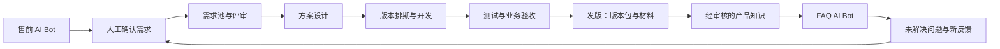

# LoopForge

**From intent to release. Continuously.**

An open-source, AI-powered product delivery platform that connects enterprise tools to standardize requirements, orchestrate sprints, and continuously adapt releases.

产品定位：开源的企业产品交付编排平台。连接企业现有管理系统，以标准化需求为核心，通过 AI 和工作流持续推进 Sprint、调整 Release，并将交付反馈带回下一轮产品迭代。

> Status: planning / pre-alpha. This repository contains project documentation and collaboration templates only; no runnable application, AI integration, connector, or deployment is implemented yet. The capabilities below describe the intended product. Trademark and domain availability have not been checked. An open-source license remains to be selected before the project can be distributed under open-source terms.

## Three foundations

- **Requirement Model** — structured requirements, explicit acceptance criteria, and traceability from business intent through delivery.
- **Connector Framework** — adapters for enterprise systems with explicit sources of truth, access controls, and reliable synchronization.
- **Loop Engine** — observe progress, detect deviations, propose a plan, execute authorized actions, verify results, and repeat.

LoopForge coordinates the tools a company already uses. A Sprint defines the team's execution cadence; a Release defines a deliverable scope. They have independent lifecycles and can have a many-to-many relationship.

## Product workflow

## Planned capabilities

| Module | Purpose |
| --- | --- |
| Discovery Bot | Capture scenarios, pain points, constraints, and expected outcomes through conversation. |
| Requirement Pool | Review, deduplicate, prioritize, assign, and trace requirements to their sources. |
| Product Design | Maintain versioned solution proposals, acceptance criteria, and review decisions. |
| Delivery Planning | Plan releases, tasks, owners, dependencies, and target dates. |
| Sprint Orchestration | Track iteration goals, blockers and carry-over work; propose changes within team policies. |
| Loop Engine | Evaluate events and deadlines, propose bounded actions, obtain required approvals and verify outcomes. |
| Enterprise Connectors | Connect CRM, chat, work tracking, code hosting, CI/CD, testing, knowledge and artifact systems. |
| Acceptance | Record test evidence, defects, business sign-off, and rejected changes. |
| Release Center | Publish approved release manifests, packages, checksums, and supporting materials. |
| Knowledge & FAQ | Answer using approved documents scoped to the caller's access and product version. |

## Project documents

- [产品需求与首版验收](docs/PRODUCT.md)
- [系统架构与领域模型](docs/ARCHITECTURE.md)
- [开发路线与任务清单](docs/ROADMAP.md)
- [Loop Engine 与自动推进规则](docs/LOOP_ENGINE.md)
- [企业系统连接规范](docs/CONNECTORS.md)
- [协作约定](CONTRIBUTING.md)
- [安全边界](SECURITY.md)

## Repository

- Name: `LoopForge`
- GitHub: https://github.com/wangchao321/LoopForge
- Visibility: public, as requested by the project owner.
- Description: `An open-source, AI-powered product delivery platform that connects enterprise tools to standardize requirements, orchestrate sprints, and continuously adapt releases.`
- Initial scope: software products and their release materials. Manufacturing BOM, procurement, and hardware lifecycle management are outside the initial scope.
- License: pending an explicit project-owner decision; no open-source license is granted by this scaffold.

## Development status

This repository currently contains planning documents and GitHub collaboration templates only. There is no install or start command yet. The first development milestone establishes a runnable application and local setup instructions.
