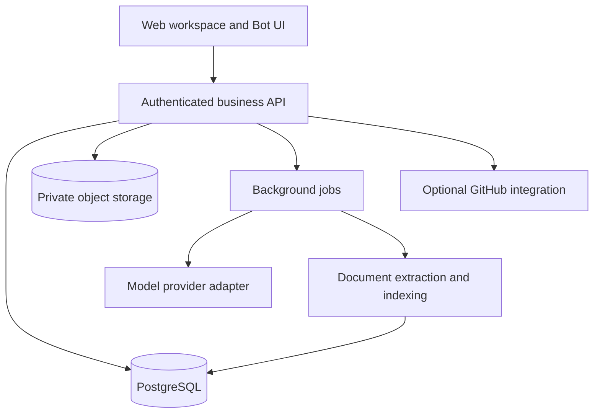

# Architecture proposal

Status: design proposal, not implemented. Framework versions and deployment choices will be verified when application development starts.

## System shape

Start with a modular monolith: a web client, one business API, and a background worker. Keep business rules in the API rather than in browser controls or AI prompts. Split services only when operational needs justify it.

Proposed implementation direction: TypeScript web client; Python API and worker; PostgreSQL for transactional data and, if suitable, knowledge retrieval indexes; S3-compatible object storage for packages and documents. A provider adapter isolates model calls. Exact frameworks, model provider, authentication provider, and versions remain undecided.

## Domain model

| Entity | Key relationships and responsibilities |
| --- | --- |
| Organization / Membership | Tenant boundary, role assignments, membership lifecycle |
| Product | Belongs to an organization; owns requirements, releases, knowledge |
| Conversation / Message | Source material with access scope and retention metadata |
| Requirement / RequirementSource | Reviewed business need with one or more original sources |
| SolutionRevision / Review | Versioned design, acceptance criteria, reviewers and decisions |
| DeliveryItem | A defined part of a requirement linked to a solution revision and target release |
| Task | Owner, dependencies, progress and optional code links for a delivery item |
| Sprint / SprintItem | Team iteration goal, time window, planned work and carry-over history, independent of releases |
| ConnectorInstance / ExternalMapping | Scoped enterprise connections, external IDs, field ownership and sync health |
| LoopRun / LoopAction / ActionApproval | Evidence-driven proposals, scoped authorization, bounded execution and verified outcomes |
| Release / ReleaseItem | Version plan plus delivery scope; stable release identity per product |
| AcceptanceRun / AcceptanceResult | Evidence bound to criteria, scope revision and build |
| Artifact / ReleaseManifest | Package metadata, checksum, storage key, documents and frozen release snapshot |
| KnowledgeDocument / KnowledgeRevision | Approved, version-scoped source with audience and revocation state |
| Feedback | FAQ question or user feedback linked back to an intake decision |
| AuditEvent / OutboxEvent | Business history and reliable asynchronous integration events |

Every tenant-owned row carries organization_id. Product-owned records also carry product_id. Database constraints and API checks must reject cross-organization and cross-product relationships, including maliciously supplied IDs. IDs alone never grant access.

## Important invariants

- Requirement acceptance is a product decision; delivery completion is computed from agreed delivery items.
- State changes, approvals and audit events are written in a single transaction, with optimistic concurrency checks.
- Repeated intake, upload completion and webhook requests use idempotency keys to prevent duplicate side effects.
- Release approval and publication re-evaluate gates server-side against the exact scope and build, including concurrent changes.
- A published manifest is immutable; withdrawal or replacement creates a new event or release revision.
- Blob downloads require authorization at request time, using short-lived links; organization paths alone are insufficient.
- FAQ retrieval filters organization, product, audience, product version and approval state before any content reaches a model; citations receive the same checks.
- Knowledge revocation invalidates both retrieval entries and answer caches. Cache keys include access scope and knowledge revision.
- Conversations and retrieved documents are untrusted content; instructions in them cannot authorize tool calls or publishing.
- AI drafts never approve requirements, promise delivery dates or publish releases autonomously.

## Integration boundaries

The platform's public source repository is independent of repositories connected by enterprise users. A public source project does not make enterprise code or data public.

GitHub integration starts with validated links. A later GitHub App integration should use scoped installation permissions, verified webhooks, retries, idempotent processing and audit records. Mapping a merged PR to a task must not automatically imply business acceptance or release publication.

The model adapter accepts structured tasks and validates structured output before persistence. Credentials remain server-side. Model execution failures preserve drafts and expose retry state. Document extraction runs as an isolated job with size/type limits; package uploads remain unavailable until validation completes.

Enterprise adapter contracts are defined in CONNECTORS.md. The Loop Engine uses these adapters and internal business commands under the authorization rules in LOOP_ENGINE.md. Neither an event nor a model response can bypass release gates or approve its own proposed action.

## Deployment and verification milestones

First establish a reproducible local environment and migrations. Then verify core workflow integration tests, permission isolation, release-gate concurrency, invalid webhook handling, knowledge revocation and restore procedures. Define load, latency, retention and recovery targets with actual deployment requirements before claiming enterprise readiness.
